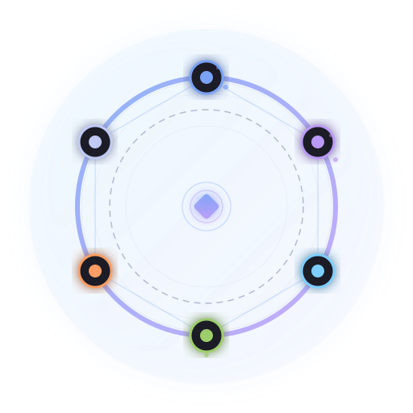

<p align="center">
  
</p>

<h1 align="center">Roundtable</h1>

<p align="center">
  <strong>Roundtable 为重要决策组织合适的专业角色，由不同 Agent 和模型承担分析，帮助你完成跨专业取舍。</strong>
</p>

<p align="center">
  <a href="#development"></a>
  <a href="LICENSE"></a>
  <a href="https://www.python.org/downloads/"></a>
  <a href="#-核心特性"></a>
</p>

<p align="center">
  <strong><a href="README.md">中文</a> · <a href="README_EN.md">English</a></strong>
</p>

<p align="center">
  
</p>

---

## 🧭 产品方向

重要决策往往需要同时考虑用户价值、技术可行性、体验与落地成本。Roundtable 的目标是帮助你组织合适的专业团队，让各角色提供具体分析，再形成可供取舍的方案。

**角色定义职责，Agent 提供上下文与工具，模型承担具体分析任务。** 三者可以分别配置；不预设某个模型永远对应某个职位，也不要求每次评审都使用更多角色或模型。

| 你需要的帮助 | 评审流程 |
|---|---|
| 分析不够全面 | 检查专业角色覆盖，为各角色明确问题、资料和交付物 |
| 不同意见难以比较 | 各自分析后，围绕影响选择的冲突交换依据和替代方案 |
| 最后仍不知道如何取舍 | 比较方案收益、成本、适用条件，保留分歧和待验证事项 |
| 决策依据容易丢失 | 记录发言与引用，区分协调者建议和用户最终选择 |

## 当前能做什么

当前 Python 核心提供会议状态、发言顺序、引用、SQLite 记录、格式化摘要及 Web Viewer。配套 Skill 和 MCP 提示词指导宿主组织评审，`decision-support` 与 `code-review` 模板提供可修改的角色职责。

**用户或协调者选角色，宿主运行 Agent 并选择模型，用户作出最终决定。** 自动组队、模型路由、语义观点提取和证据验证尚未实现。`convergence_score` 由外部写入的共识/分歧标注计算，可能为 `None`，不代表答案正确率；`summarize()` 整理记录，不替代专业综合判断。

当前源码还支持带来源和历史版本的简报更新、关联发言的观点标注，以及通过 HTTP 工具获取角色提示词。结论可从读取、摘要和导出中完整取回；轮次显示区分实际评审与引擎游标。接口与使用顺序见 [使用指南](docs/DECISION_WORKFLOW.md)。

完整方向和验收标准见 [产品方向](docs/product/DIRECTION.md)，模板与当前流程见 [决策评审指南](docs/DECISION_WORKFLOW.md)。这些改动位于源码；安装发布包前请核对其版本与能力，不能据此假定已同步发布。

## 🧩 适合场景

- **项目去留与方向**：继续维护、调整或停止，明确投入边界。
- **产品范围与优先级**：服务谁、先做什么、哪些需求暂缓。
- **技术路线**：自研或采购、架构选型、迁移与维护的取舍。
- **发布与实施**：上线条件、实施路径、阻塞项与回滚条件。
- **资源与商业模式**：预算和人力如何分配，免费、订阅或按量收费如何取舍。
- **工作流程与工具选择**：是否引入工具，比较收益与迁移、培训、维护成本。
- **Code Review**：围绕具体改动检查正确性、架构、安全与可靠性，输出可操作的问题和合并建议。

这七类场景都在产品范围内，实际验证可分批开展。它们共用评审流程，按场景调整角色、材料和交付物；当前并非已有七套独立自动化实现。详见 [场景清单](docs/product/DIRECTION.md#场景清单)。普通事实查询或容易撤销的小选择，可以直接由单个助手处理。

## 🚀 快速开始

### 安装

正式包名是 `agent-roundtable`：

```bash
pip install agent-roundtable
```

需要验证当前分支或本地修改时，可从源码安装：

```bash
git clone https://github.com/MoyuFamily/agent-roundtable.git
cd agent-roundtable
pip install -e .
```

> 说明：本项目的 PyPI 包名是 `agent-roundtable`。PyPI 上的 `roundtable` / `roundtable-ai` 不是本项目，请勿使用 `pip install roundtable` 或 `pip install roundtable-ai` 安装本项目。

### 跨平台 MCP 模式

让 Claude Code、Cursor、Windsurf 等 MCP-capable agent 加入同一个圆桌：

```bash
# 在上面克隆的源码目录执行；当前服务接口按 MCP 1.x 验证
pip install -e ".[mcp]" "mcp>=1,<2"
python3 -m roundtable.skills.mcp-roundtable.install --platform=auto
```

安装脚本会把 MCP server 的 `command` 写成当前 Python 解释器路径，适配 venv 和没有 `python` 命令的 macOS/Linux 环境。手动配置时建议优先使用 `python3`。

已接入的 Agent 可以做协调者，并通过 invitation 邀请参与者。需要 HTTP 接入的宿主可使用桥接入口：

```bash
python3 -m roundtable.codex
```

也可以在 Python 里手动启动 `roundtable.mcp.bridges.codex.CodexBridge` 或 `roundtable.mcp.bridges.GenericBridge`，给 WorkBuddy 等 HTTP-capable 平台接入。详见 [docs/architecture.md](docs/architecture.md)。

### 基本用法

下面演示记录流程：调用者提供发言和结论，Roundtable 管理轮次与持久化。实际评审由宿主运行各角色 Agent；此示例不会调用模型。

```python
from roundtable import RoundtableCore

core = RoundtableCore()

# 1. 创建讨论
result = core.create_discussion(
    topic="选择数据库：PostgreSQL vs MySQL vs TiDB",
    participants=[
        {"profile": "backend_architect", "role": "后端架构师", "display_name": "Backend Architect"},
        {"profile": "ops_engineer", "role": "运维工程师", "display_name": "Ops Engineer"},
        {"profile": "product_manager", "role": "产品经理", "display_name": "Product Manager"},
    ],
    max_rounds=3,
)
disc_id = result["discussion_id"]
if result["web_status"] == "ready":
    print(f"Web Viewer: {result['web_url']}")
elif result["web_status"] == "failed":
    print(result["web_error"])
    print(result["web_help"])

# 2. 协调者开场（round 0 保留给 coordinator）
core.speak(disc_id, "coordinator", "开场：围绕数据库选型展开圆桌讨论。")

# 3. 参与者发言
core.speak(disc_id, "backend_architect", "PostgreSQL 的 JSON 和事务能力更适合复杂业务建模。")
core.speak(disc_id, "ops_engineer", "MySQL 运维经验和工具链更成熟，团队上手成本低。")
core.speak(disc_id, "product_manager", "从迭代速度看，我们需要优先保证未来功能扩展能力。")

# 4. 查看讨论状态（没有外部 findings 标注时，收敛度为 None）
status = core.status(disc_id)
print(f"Convergence: {status['convergence_score']}")

# 5. 获取格式化摘要，供协调者核对与综合
summary = core.summarize(disc_id, compact=True)
print(summary["structured_summary"])

# 6. 记录建议，区分建议与用户已确认的决定
core.end_discussion(disc_id, conclusion="建议选择 PostgreSQL；待验证迁移成本与运维条件，等待用户确认。")
```

### 默认 Web Viewer

`create_discussion()` 默认 `web=True`，会尽力启动本地 Web Viewer，这是 Roundtable 的核心体验之一。核心讨论创建优先成功；如果本机没有 Node.js、npm 依赖安装失败或端口不可用，返回值会包含：

- `web_status`: `"ready"`、`"failed"` 或 `"disabled"`
- `web_url`: Viewer 地址，失败时为 `None`
- `web_error` / `web_help`: 可读诊断和修复提示

Web Viewer 需要 Node.js 18+。Roundtable 会复用已在线服务、直接启动 `node server.mjs`，并在缺少本地 npm 依赖时尝试 `npm install --omit=dev`；不会自动安装 Node 本体，也不会无提示安装全局 PM2。自动安装会跳过 Puppeteer 的 Chromium 下载；Markdown 导出始终可用，PDF 导出缺浏览器时会返回清晰诊断。

### 错误安全模式（推荐用于生产环境）

```python
from roundtable.adapters.generic import Roundtable

rt = Roundtable(db_path="/tmp/discussions.db")
result = rt.init(topic="...", participants=[...])
# 所有方法返回 dict — 错误以 {"error": "msg"} 返回，永不抛异常
```

### 实时通知

```python
def my_send(platform, chat_id, message):
    print(f"[{platform}:{chat_id}] {message}")

rt = Roundtable(send_fn=my_send)
result = rt.init(
    topic="架构评审",
    participants=[...],
    notifications={
        "enabled": True,
        "channels": [
            {"platform": "feishu", "chat_id": "oc_xxx"},
            {"platform": "slack", "chat_id": "#engineering"},
        ],
        "events": ["round_end", "concluded"],
    },
)
```

## ✨ 核心特性

| 特性 | 说明 |
|------|------|
| 🧑‍⚖️ **圆桌讨论模型** | 用 topic、participants、rounds 管理多 Agent 讨论流程 |
| 📊 **标注比例** | 根据已有共识/分歧标注计算比例；不自动提取，也不作为质量指标 |
| 🧾 **决策材料** | 汇集记录与格式化摘要，由协调者比较方案、保留分歧并记录建议 |
| 🔌 **宿主集成** | 通过 Python API、工具或桥接记录评审；Agent 执行与模型选择由宿主负责 |
| 🖥️ **默认 Web Viewer** | 创建讨论时默认尽力启动实时 Viewer，失败不阻断核心讨论 |
| 🔔 **实时通知** | 讨论事件推送到飞书、Slack 或任意消息平台 |
| 🛡️ **错误安全** | Generic adapter 所有方法返回 dict，永不抛异常 |
| 🗂️ **SQLite 持久化** | 讨论记录持久存储，随时回溯 |
| 🪶 **零依赖核心** | 核心库只用 Python 标准库（sqlite3 + dataclasses） |

## 🔌 为 Hermes Agent 集成而生

Roundtable 可以独立作为 Python 库使用，也可以作为 Hermes Agent 的 toolset 使用，让多个 Agent 通过工具调用参与同一场结构化讨论。

```yaml
# Hermes 配置
toolsets:
  - roundtable
```

安装 Hermes Agent 后，Roundtable 可注册讨论相关工具，AI Agent 能够创建、参与、读取、总结和结束讨论。

## 📐 架构

```text
src/roundtable/
├── __init__.py       # 公共 API
├── core.py           # 业务逻辑层
├── db.py             # SQLite 存储层
├── models.py         # 数据模型（dataclass）
├── notify.py         # 通知分发
├── exceptions.py     # 异常定义
├── web_publisher.py  # 本地 Web Viewer 发布器
├── adapters/         # Hermes / generic 等适配器
├── mcp/              # MCP server、tools 与跨平台 bridge
├── web/              # Web Viewer 静态资源与 Node server
└── templates/        # 讨论模板
```

### 🖼️ 嵌入分享（iframe Embed）

将圆桌讨论嵌入到任意网页、博客或文档中：

```html
<iframe
  src="https://roundtable.izmw.me/embed/<token>"
  width="100%" height="600" frameborder="0"
  style="border:1px solid #334155;border-radius:12px"
  sandbox="allow-scripts allow-same-origin allow-popups">
</iframe>
```

- `/embed/:token` 提供精简视图：无顶部导航、无分享/导出按钮、无回放控件
- 支持实时 SSE 推送，嵌入页面可实时看到新发言
- 密码保护的讨论会显示"在新标签页打开"提示
- 分享弹窗中可一键复制嵌入代码

## 🛣️ 后续计划

1. **可靠完成一次真实评审**：修复 MCP 兼容、通知与消息确认，验证双客户端流程及发布包。
2. **验证专业协作的增益**：检查角色覆盖、分析深度和方案取舍，对比单助手及独立多角色汇总。
3. **按真实使用增加自动化**：反复出现组织负担时，再投入角色建议、模型匹配与结构化证据管理。

先用真实决策验证价值，再决定保持轻量 Skill、继续独立维护或收缩范围。详见 [产品方向](docs/product/DIRECTION.md)。

## 🤝 贡献

1. Fork 本仓库
2. 创建特性分支：`git checkout -b feature/amazing-feature`
3. 编写测试并确保通过：`pytest tests/ -v`
4. 提交代码：`git commit -m 'feat: add amazing feature'`
5. 推送并创建 PR

### 代码规范

- Python 3.10+，使用 type hints
- 核心库零外部依赖（stdlib only）
- 自定义业务异常继承 `RoundtableError`；校验和环境错误可能使用标准异常
- 高层 Core / adapter 方法返回 JSON-serializable dict

## 👥 团队

| 成员 | 角色 | 说明 |
|------|------|------|
|  饼哥 | 产品总监 | 十年产品老兵，擅长把模糊需求变成可落地的 MVP，信奉「用户要的不是钻头，是墙上的洞」 |
|  像素姐 | 设计总监 | UI/UX 与品牌视觉体系设计，专注交互细节与用户体验优化，信奉「细节决定品质感」 |
|  码飞 | 技术总监 | 全栈开发与系统架构设计，主导技术选型、性能优化和 AI/ML 工程化落地 |
|  小赫 | 协调者 | 团队任务统筹与进度管理，确保产品→设计→开发流程高效运转 |

## 📄 许可证

[Apache-2.0](LICENSE)
